# KeysMultitude

Сравнение реализаций упорядоченного множества целых ключей. Бенчмарки показывают, как выбор структуры зависит от размера множества, доли вставок, распределения ключей и типа запроса.

| Операция | Что измеряем |
|---|---|
| `insert` | Вставка нового уникального ключа |
| `range_count` | Число ключей в интервале `(l, r]` |
| `select_rank` | Поиск ключа по порядковому номеру, начиная с 1 |
| `count_less` | Число ключей, строго меньших `x` |

В общих сравнениях участвуют отсортированный `std::vector`, `std::set`, AVL-дерево, красно-чёрное дерево и B-дерево. AVL, красно-чёрное и B-дерево хранят размеры поддеревьев, чтобы считать позиции и находить ключи по рангу.

## Как запустить

В Linux или WSL из корня проекта. Среда Nix предоставляет зависимости, компилятор, CMake и средства построения графиков.

```bash
nix develop
cmake --preset benchmarks
cmake --build --preset benchmarks --parallel 4
python3 benchmarks/run.py list
```

### Наборы замеров

| Suite | Что меняется | Сохранённые результаты |
|---|---|---|
| [`btree-degree.toml`](benchmarks/suites/btree-degree.toml) | Выбор оптимального `t` среди степеней от 2 до 256 на 1 000 000 ключей | [Вставка](benchmarks/results/btreeDegreeDependency/fixedSize1000000/insert/summary.md) · [Запросы](benchmarks/results/btreeDegreeDependency/fixedSize1000000/queries/summary.md) |
| [`default.toml`](benchmarks/suites/default.toml) | Размер множества от 200 до 1 000 000, каждая операция отдельно | [Вставка](benchmarks/results/multitudeSizeDependency/insert/summary.md) · [Запросы](benchmarks/results/multitudeSizeDependency/queries/summary.md) |
| [`insert-query-ratio.toml`](benchmarks/suites/insert-query-ratio.toml) | Доля вставок от 0 до 100% с шагом 5%. Текущий suite запускается на 1 000 000 ключей | [Отчёт прогона на 64 000](benchmarks/results/insertQueryRatioDependency/summary.md) |
| [`product-catalog.toml`](benchmarks/suites/product-catalog.toml) | Нагрузка по модели каталога товаров на множествах от 64 000 до 1 000 000 ключей | [Отчёт и график](benchmarks/results/productCatalog/summary.md) |

```bash
python3 benchmarks/run.py --suite benchmarks/suites/btree-degree.toml
python3 benchmarks/run.py
python3 benchmarks/run.py --suite benchmarks/suites/insert-query-ratio.toml
python3 benchmarks/run.py --suite benchmarks/suites/product-catalog.toml
```

Каждый запуск создаёт каталог под `build/benchmark-results` с исходным JSON, CSV, отчётом и графиками. Путь можно задать через `--output`, указав новый каталог. Для быстрой проверки одной операции достаточно короткого прогона.

```bash
python3 benchmarks/run.py run --workloads count_less --backends btree32 \
  --sizes 64000 --iterations 1 --repetitions 1 --no-plot
```

## Методика

- Все сохранённые серии выполнены в WSL через Nix в конфигурации Release, с Google Benchmark 1.9.4 и пятью повторами каждого кейса.
- Для заданного кейса входные данные генерируются с фиксированным seed. Все бэкенды получают одинаковый начальный набор ключей в одном порядке и одинаковую последовательность операций.
- В нагрузках со вставками перед каждым батчем создаётся и заполняется новое множество. Генерация входа, начальное заполнение и уничтожение множества проходят вне замера. В изолированных замерах запросов множество заполняется один раз перед циклом.
- `mean_ns_per_op` — среднее времени процессора на операцию по повторам. На графиках по размеру полоса показывает минимум и максимум. `median_ops_per_second` — медиана пропускной способности в операциях в секунду. В смешанной нагрузке обе метрики описывают весь батч.
- На время влияют размер и порядок вставки ключей, локальность запросов и пропорции операций. Указанные ниже границы относятся к проверенным точкам и этой машине.

## 1. Выбор оптимальной степени B-дерева

При размере в 1 000 000 ключей проверены 13 значений `t` от 2 до 256 на тех же изолированных операциях. Для сводного графика рассчитано среднее четырёх отдельных замеров с весом 25% для каждой операции.

В сохранённом прогоне минимум этого показателя у **`t = 32` — 334 нс/оп**. Эта же степень показала лучшее среднее для вставки и подсчёта в диапазоне. Для выбора по рангу и подсчёта меньших ключей лучшее среднее у `t = 48`. По этому критерию для остальных экспериментов выбрали `t = 32`.

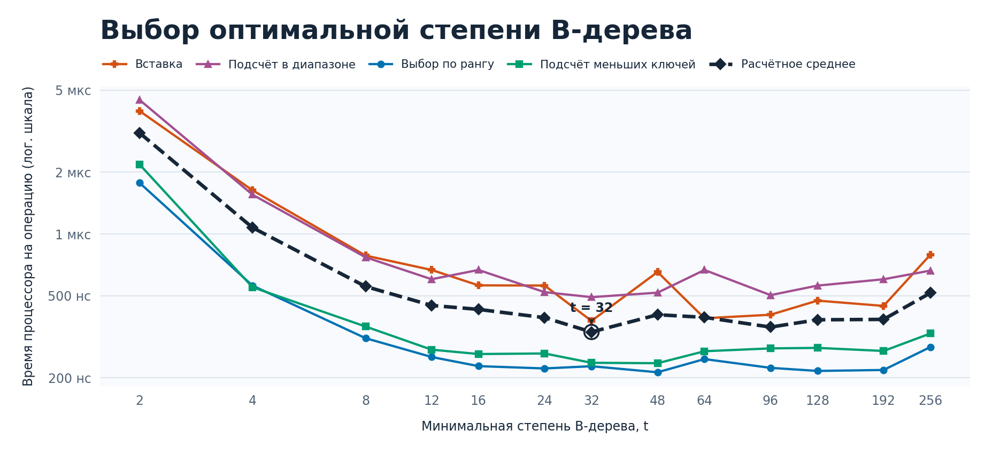

<details>
<summary>Степень B-дерева по отдельным операциям</summary>

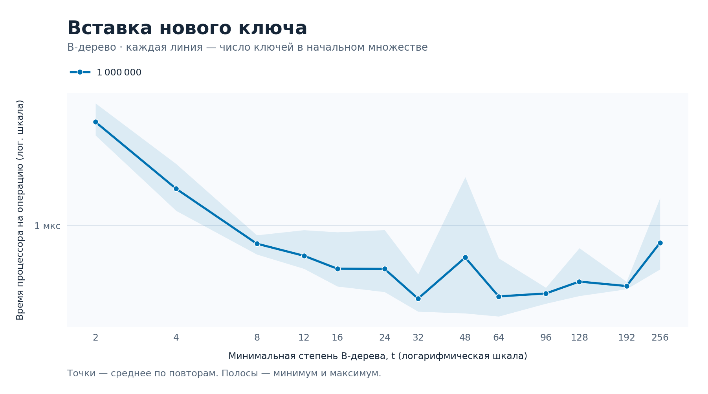

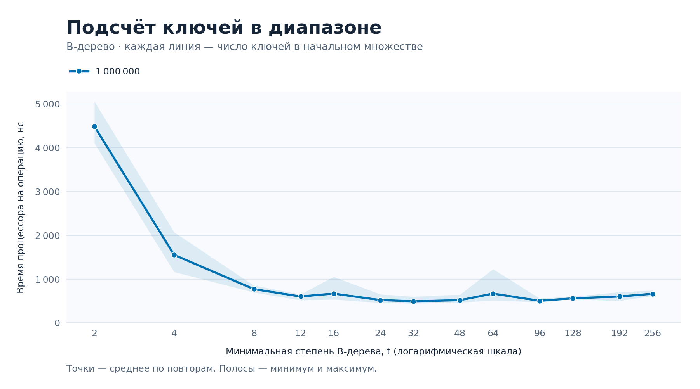

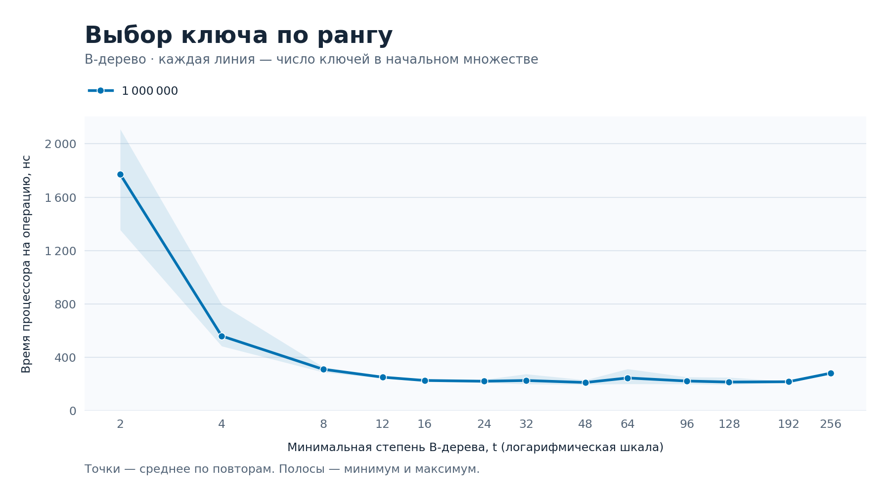

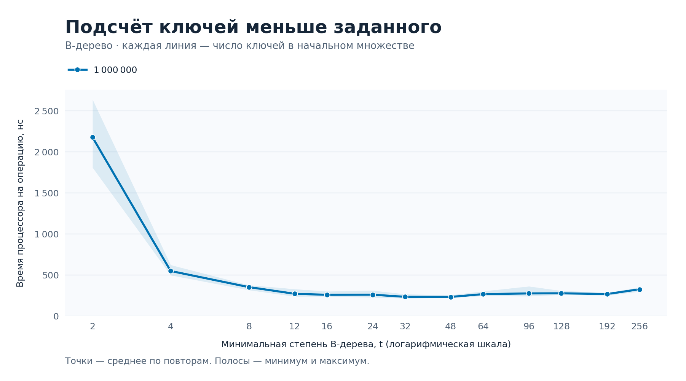

</details>

Список специализаций задаётся в `btree-degree.toml`. После добавления новой степени нужно пересобрать бенчмарки, поскольку `t` — параметр шаблона.

## 2. Влияние размера множества

Проверены размеры 200, 1 000, 4 000, 16 000, 64 000, 250 000 и 1 000 000. Множество заполняется случайно перемешанными чётными ключами. Для вставок берутся уникальные нечётные ключи из того же диапазона, чтобы они попадали внутрь множества. Батч содержит от 16 до 256 вставок в зависимости от начального размера. Запросы измеряются отдельно: границы и ранги распределены по множеству, а каждый запрос по диапазону охватывает около 1% ключей.

Среднее время на **1 000 000 ключей**, нс/оп.

| Бэкенд | Вставка | Диапазон | Выбор по рангу | Подсчёт меньших |
|---|---:|---:|---:|---:|
| Отсортированный вектор | 48 539 | **245** | **2,48** | **118** |
| `std::set` | 1 438 | 1 633 005 | 78 144 342 | 85 161 149 |
| AVL-дерево | 2 274 | 1 988 | 819 | 650 |
| Красно-чёрное дерево | 1 940 | 1 705 | 699 | 780 |
| B-дерево, `t = 32` | **552** | 480 | 240 | 258 |

Вектор показал лучшее среднее по всем трём запросам на всех проверенных размерах. Бинарный поиск даёт границы диапазона, а доступ по индексу даёт ключ по рангу. На вставке вектор лидировал до 4 000 ключей включительно, а с 16 000 на проверенной сетке лидировало B-дерево. На миллионе медианная пропускная способность вставок составила около **2,39 млн оп/с** для B-дерева и **23 тыс. оп/с** для вектора.

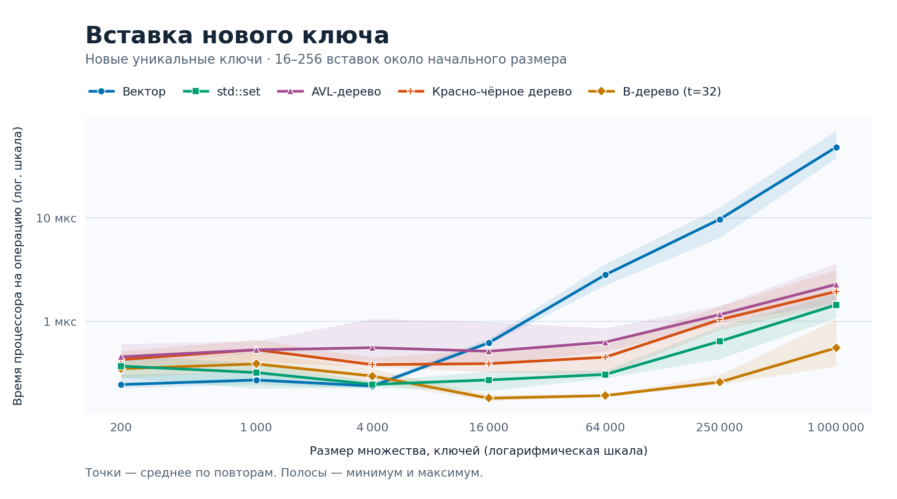

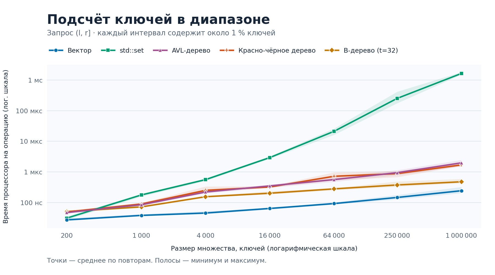

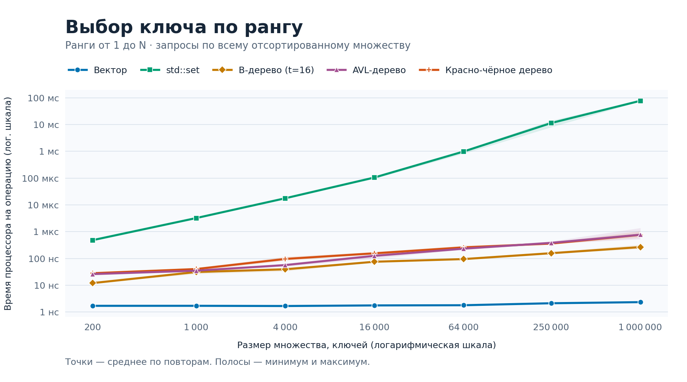

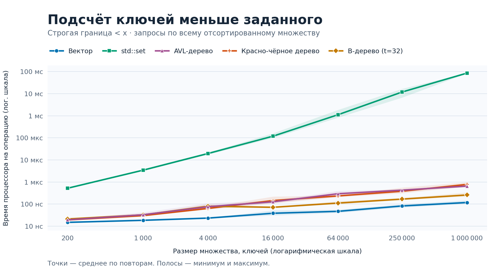

## 3. Влияние доли вставок

В каждом батче 300 перемешанных операций. Доля вставок меняется от 0 до 100% с шагом 5%. Измеряются четыре профиля: вставки с каждым из трёх типов запросов отдельно и вставки со смесью, где запросы трёх типов встречаются поровну. Каждый батч начинается с одного и того же размера, затем множество растёт от поступающих вставок.

**Сохранённая серия снята на 64 000 ключей.** Текущий suite задан на 1 000 000 ключей. Результаты ниже относятся к сохранённому прогону.

| Профиль запросов | Где лучшее медианное время у вектора | Где лучшее медианное время у B-дерева |
|---|---|---|
| Подсчёт в диапазоне | 0% и 5% вставок | От 10% вставок |
| Выбор по рангу | 0% вставок | От 5% вставок |
| Подсчёт меньших ключей | 0% вставок | От 5% вставок |
| Равная смесь трёх запросов | 0% вставок | От 5% вставок |

На точке с 5% вставок и выбором по рангу отрыв B-дерева от второго бэкенда составляет всего 1,4%. Точную точку смены лидера между измеренными долями эта сетка не определяет. [Таблица отрывов](benchmarks/results/insertQueryRatioDependency/insertQueryWinners.csv)

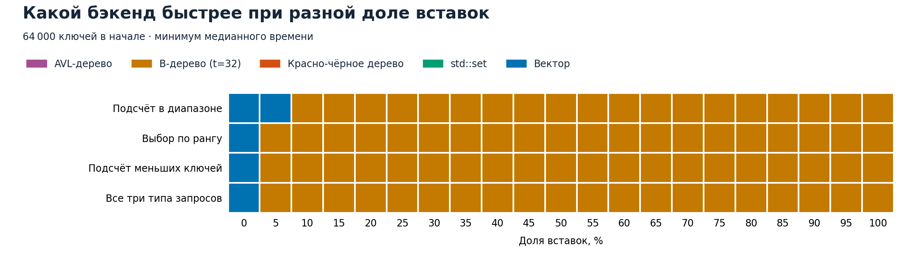

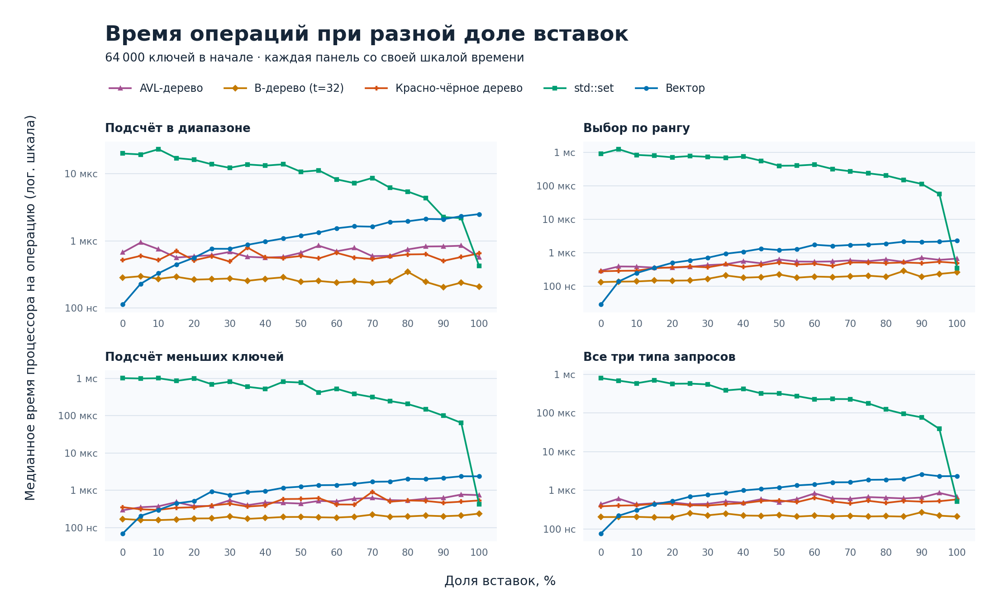

## 4. Реалистичная смешанная нагрузка на KeysMultitude

Для этого эксперимента подобрали синтетическую нагрузку на `KeysMultitude` по примеру каталога интернет-магазина. Покупатели чаще фильтруют товары по цене и открывают первые страницы выдачи, а новые предложения поступают между запросами. Цена нового предложения может попасть в любую часть индекса. В ключе цена определяет порядок сортировки, а идентификатор позволяет отдельно учесть предложения с одинаковой ценой.

В батче **1 000 перемешанных операций**. Их пропорции моделируют преобладание чтения в каталоге.

| Доля | Операция KeysMultitude | Действие в каталоге |
|---:|---|---|
| 5% | `insert` | Добавить новое предложение |
| 75% | `range_count` | Показать число товаров в выбранном ценовом диапазоне |
| 15% | `count_less` | Посчитать, сколько товаров укладывается в бюджет |
| 5% | `select_rank` | Найти товар на заданной позиции при сортировке по цене |

Цены генерируются с шагом 100 ₽ в трёх сегментах. Вероятности сегментов составляют 55% для 500–3 000 ₽, 35% для 3 100–7 500 ₽ и 10% для 7 600–20 000 ₽. Ценовые фильтры выбираются с одинаковой наибольшей вероятностью для диапазонов 500–1 000 ₽ и 1 000–2 000 ₽. В 85% запросов по позиции ранг выбирается среди первых 60 товаров, в остальных — по всему каталогу. Начальный размер — 64 000, 250 000 или 1 000 000 предложений. [Генератор нагрузки](benchmarks/workloads/productCatalog.hpp)

| Начальное число товаров | Бэкенд с лучшим средним | Среднее, нс/оп | Медиана, млн оп/с |
|---:|---|---:|---:|
| 64 000 | Вектор | 179 | 5,74 |
| 250 000 | AVL | 214 | 5,42 |
| 1 000 000 | AVL | 313 | 3,65 |

На миллионе у B-дерева получилось 359 нс/оп, а у вектора — 2 545 нс/оп. Диапазоны повторов AVL и B-дерева пересекаются. Даже редкие вставки могут заметно замедлить большой вектор, когда новые ключи распределены по всему ценовому индексу. [Подробные таблицы](benchmarks/results/productCatalog/summary.md)

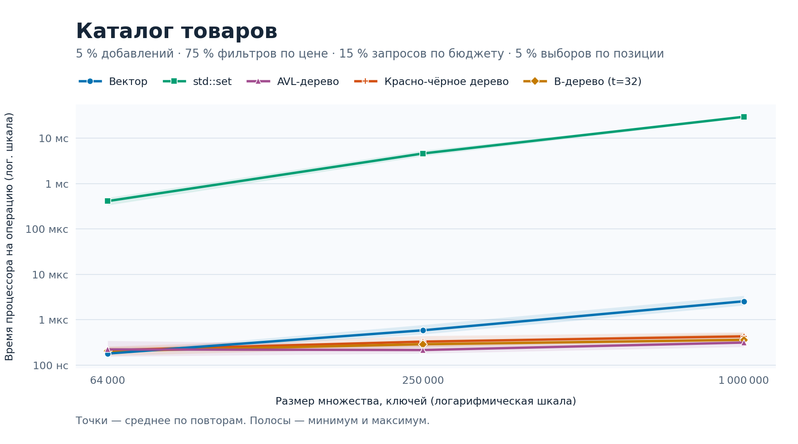

## Границы применимости

- **Отсортированный вектор** подходит для чтения и небольших множеств. Дорогими становятся вставки внутрь большого массива, потому что нужно сдвигать его хвост.
- **B-дерево** показало лучший результат на случайных вставках в средние и большие множества и выиграло большинство смешанных профилей при 64 000 ключей. **AVL и красно-чёрное дерево** дают логарифмические операции при поддержке размеров поддеревьев. AVL показало лучшее среднее в большом каталоге.
- **`std::set`** поддерживает логарифмическую вставку и поиск границ. В этой реализации подсчёт между границами и поиск по рангу требуют прохода по итераторам, поэтому такие запросы резко дорожают с ростом множества.

## Как устроены бенчмарки

Сценарий и генерация его данных находятся в [`workloads`](benchmarks/workloads). Общие циклы замера вынесены в [`workloadTemplates.hpp`](benchmarks/workloads/workloadTemplates.hpp). [Регистрация](benchmarks/registerWorkload.cpp) связывает сценарий с бэкендами и аргументами Google Benchmark. [`run.py`](benchmarks/run.py) выбирает кейсы по TOML и запускает их, а [`reporting`](benchmarks/reporting) преобразует замеры в таблицы и графики.
