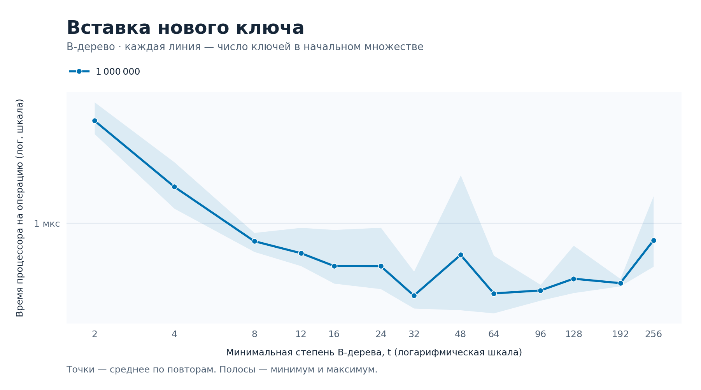

# Результаты бенчмарков

Меньше времени на операцию — лучше.
Графики показывают измеренное время и разброс повторов.

## Вставка нового ключа

[CSV](insert.csv)

Новые уникальные ключи · 16–256 вставок около начального размера
В таблице — среднее время процессора на операцию, нс.

| Размер множества | t = 2 | t = 4 | t = 8 | t = 12 | t = 16 | t = 24 | t = 32 | t = 48 | t = 64 | t = 96 | t = 128 | t = 192 | t = 256 |
|---:|---:|---:|---:|---:|---:|---:|---:|---:|---:|---:|---:|---:|---:|
| 1 000 000 | 3 962,46 | 1 629,96 | 785,08 | 668,24 | 562,37 | 561,27 | 377,78 | 653,21 | 389,11 | 404,77 | 474,06 | 446,72 | 793,36 |

