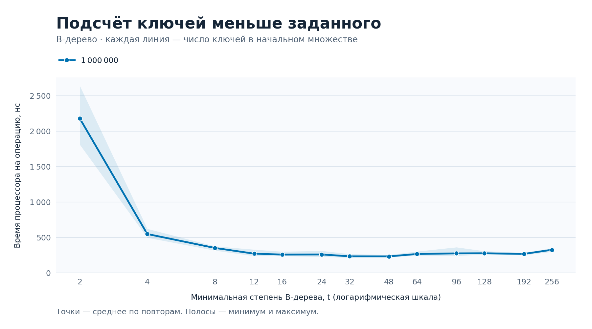
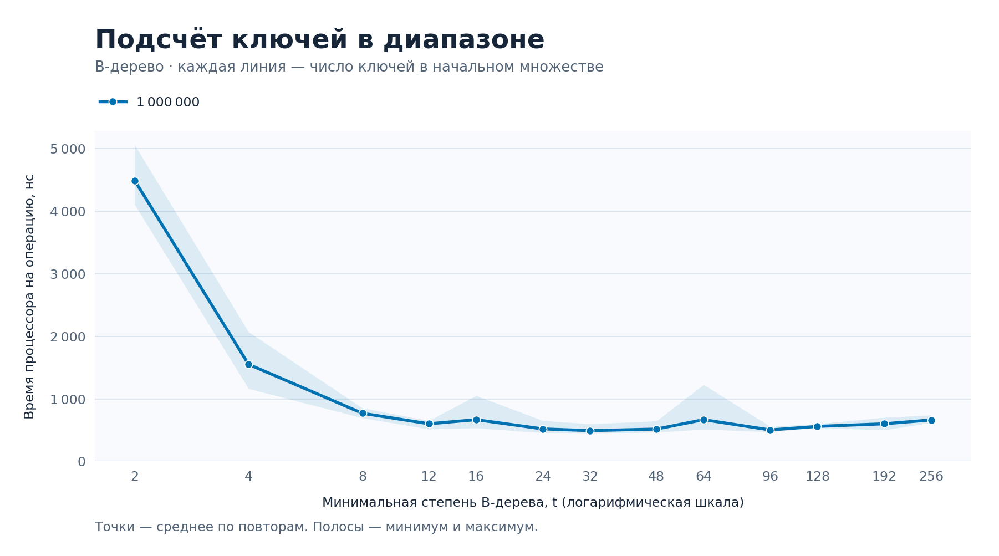
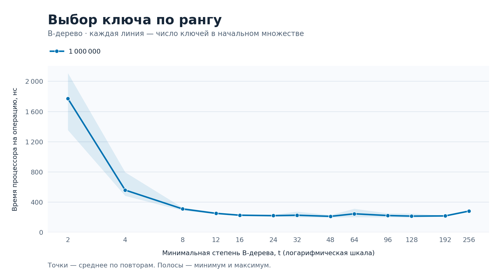

# Результаты бенчмарков

Меньше времени на операцию — лучше.
Графики показывают измеренное время и разброс повторов.

## Подсчёт ключей меньше заданного

[CSV](count_less.csv)

Строгая граница < x · запросы по всему отсортированному множеству
В таблице — среднее время процессора на операцию, нс.

| Размер множества | t = 2 | t = 4 | t = 8 | t = 12 | t = 16 | t = 24 | t = 32 | t = 48 | t = 64 | t = 96 | t = 128 | t = 192 | t = 256 |
|---:|---:|---:|---:|---:|---:|---:|---:|---:|---:|---:|---:|---:|---:|
| 1 000 000 | 2 178,30 | 550,64 | 354,77 | 273,73 | 260,67 | 262,33 | 236,32 | 235,21 | 268,98 | 277,69 | 279,24 | 269,79 | 328,20 |

## Подсчёт ключей в диапазоне

[CSV](range_count.csv)

Запрос (l, r] · каждый интервал содержит около 1 % ключей
В таблице — среднее время процессора на операцию, нс.

| Размер множества | t = 2 | t = 4 | t = 8 | t = 12 | t = 16 | t = 24 | t = 32 | t = 48 | t = 64 | t = 96 | t = 128 | t = 192 | t = 256 |
|---:|---:|---:|---:|---:|---:|---:|---:|---:|---:|---:|---:|---:|---:|
| 1 000 000 | 4 486,14 | 1 552,07 | 770,50 | 602,35 | 668,11 | 521,18 | 492,97 | 518,16 | 667,96 | 504,12 | 560,83 | 602,04 | 663,60 |

## Выбор ключа по рангу

[CSV](select_rank.csv)

Ранги от 1 до N · запросы по всему отсортированному множеству
В таблице — среднее время процессора на операцию, нс.

| Размер множества | t = 2 | t = 4 | t = 8 | t = 12 | t = 16 | t = 24 | t = 32 | t = 48 | t = 64 | t = 96 | t = 128 | t = 192 | t = 256 |
|---:|---:|---:|---:|---:|---:|---:|---:|---:|---:|---:|---:|---:|---:|
| 1 000 000 | 1 772,47 | 560,68 | 311,33 | 252,19 | 227,66 | 221,82 | 227,46 | 212,51 | 246,35 | 223,30 | 215,76 | 218,06 | 281,97 |

