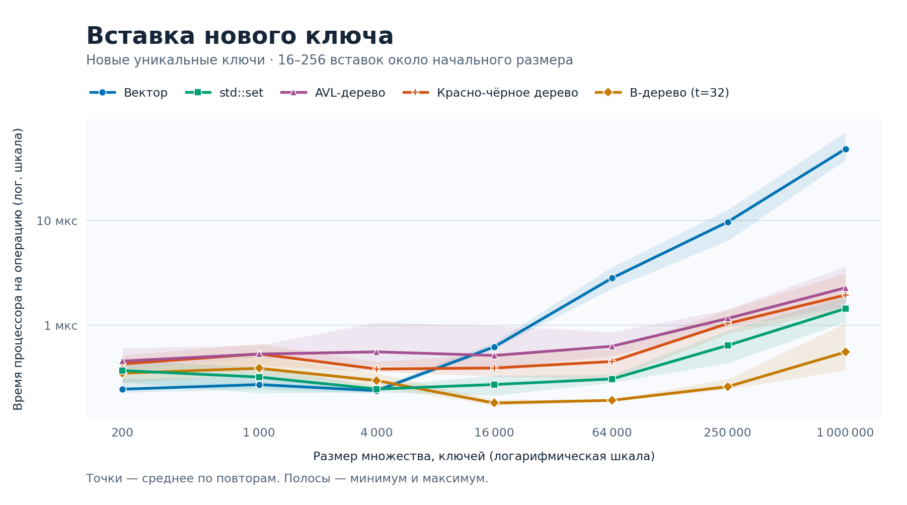

# Результаты бенчмарков

Меньше времени на операцию — лучше.
Графики показывают измеренное время и разброс повторов.

## Вставка нового ключа

[CSV](insert.csv)

Новые уникальные ключи · 16–256 вставок около начального размера
В таблице — среднее время процессора на операцию, нс.

| Размер множества | AVL-дерево | B-дерево (t=32) | Красно-чёрное дерево | std::set | Вектор |
|---:|---:|---:|---:|---:|---:|
| 200 | 452,34 | 346,67 | 424,40 | 367,54 | 243,59 |
| 1 000 | 528,10 | 386,09 | 529,61 | 318,46 | 269,61 |
| 4 000 | 554,16 | 294,56 | 380,06 | 244,35 | 235,90 |
| 16 000 | 512,04 | 179,56 | 388,43 | 270,09 | 618,90 |
| 64 000 | 627,26 | 190,58 | 448,29 | 305,23 | 2 818,21 |
| 250 000 | 1 157,97 | 257,54 | 1 036,33 | 639,32 | 9 709,71 |
| 1 000 000 | 2 273,75 | 551,85 | 1 940,16 | 1 438,15 | 48 539,42 |

