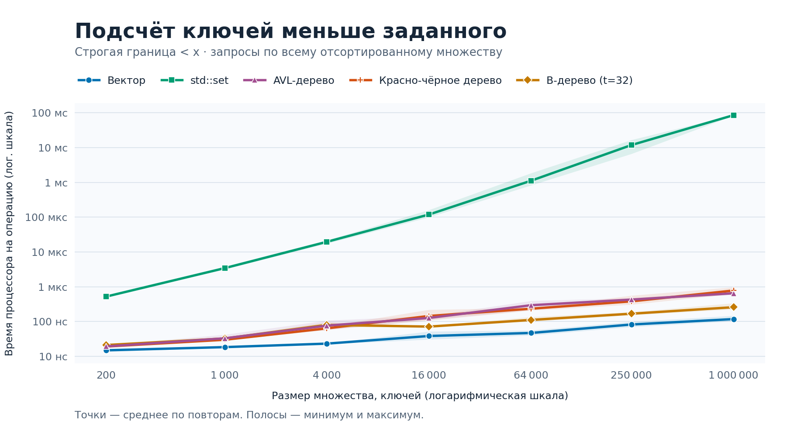
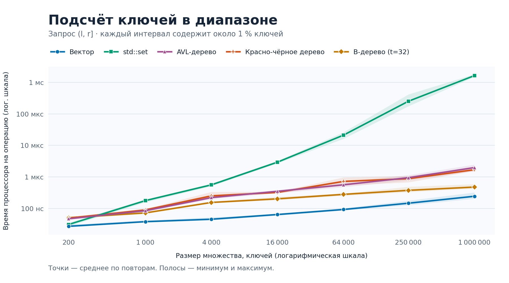
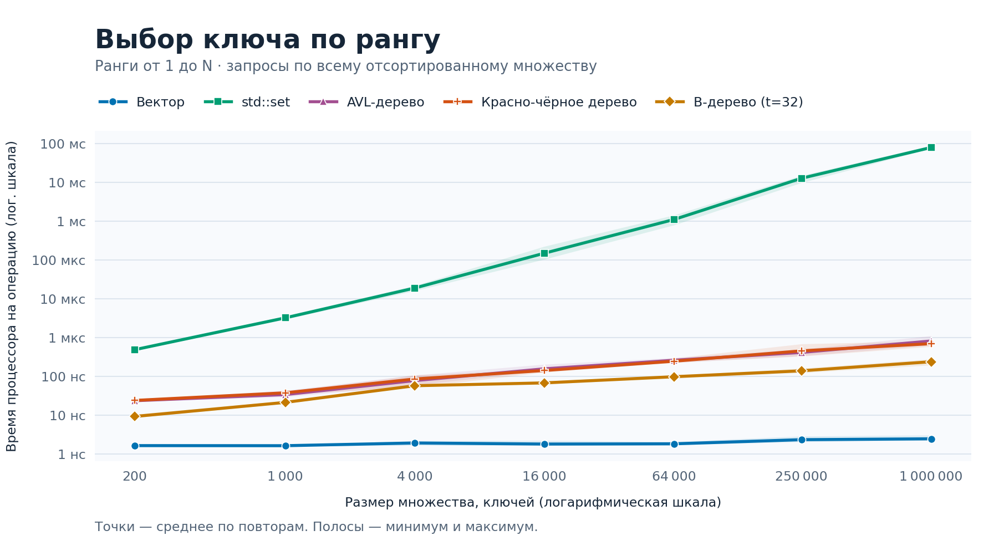

# Результаты бенчмарков

Меньше времени на операцию — лучше.
Графики показывают измеренное время и разброс повторов.

## Подсчёт ключей меньше заданного

[CSV](count_less.csv)

Строгая граница < x · запросы по всему отсортированному множеству
В таблице — среднее время процессора на операцию, нс.

| Размер множества | AVL-дерево | B-дерево (t=32) | Красно-чёрное дерево | std::set | Вектор |
|---:|---:|---:|---:|---:|---:|
| 200 | 19,36 | 21,14 | 19,15 | 521,25 | 14,91 |
| 1 000 | 32,94 | 32,67 | 29,95 | 3 425,29 | 18,42 |
| 4 000 | 76,25 | 80,14 | 63,71 | 19 527,86 | 23,21 |
| 16 000 | 126,97 | 71,57 | 144,57 | 118 858,70 | 38,42 |
| 64 000 | 294,44 | 111,22 | 233,94 | 1 113 596,80 | 47,03 |
| 250 000 | 427,11 | 168,00 | 380,74 | 11 796 061,47 | 82,23 |
| 1 000 000 | 650,40 | 258,13 | 779,84 | 85 161 149,12 | 117,74 |

## Подсчёт ключей в диапазоне

[CSV](range_count.csv)

Запрос (l, r] · каждый интервал содержит около 1 % ключей
В таблице — среднее время процессора на операцию, нс.

| Размер множества | AVL-дерево | B-дерево (t=32) | Красно-чёрное дерево | std::set | Вектор |
|---:|---:|---:|---:|---:|---:|
| 200 | 47,49 | 51,11 | 49,67 | 31,30 | 27,46 |
| 1 000 | 85,47 | 72,76 | 90,47 | 178,40 | 38,43 |
| 4 000 | 222,07 | 156,25 | 252,67 | 564,35 | 45,97 |
| 16 000 | 352,75 | 203,35 | 324,19 | 2 952,02 | 64,81 |
| 64 000 | 566,15 | 281,85 | 725,97 | 21 204,23 | 93,43 |
| 250 000 | 950,87 | 377,73 | 884,29 | 251 277,58 | 147,77 |
| 1 000 000 | 1 987,65 | 479,69 | 1 704,93 | 1 633 005,24 | 245,34 |

## Выбор ключа по рангу

[CSV](select_rank.csv)

Ранги от 1 до N · запросы по всему отсортированному множеству
В таблице — среднее время процессора на операцию, нс.

| Размер множества | AVL-дерево | B-дерево (t=32) | Красно-чёрное дерево | std::set | Вектор |
|---:|---:|---:|---:|---:|---:|
| 200 | 23,75 | 9,35 | 24,17 | 488,28 | 1,66 |
| 1 000 | 34,13 | 21,50 | 37,92 | 3 218,25 | 1,65 |
| 4 000 | 78,32 | 57,76 | 86,07 | 18 889,56 | 1,94 |
| 16 000 | 157,30 | 68,27 | 142,41 | 148 798,78 | 1,82 |
| 64 000 | 261,22 | 98,54 | 247,03 | 1 097 463,16 | 1,85 |
| 250 000 | 415,54 | 139,74 | 455,55 | 12 601 205,37 | 2,36 |
| 1 000 000 | 818,53 | 239,59 | 699,22 | 78 144 341,64 | 2,48 |

