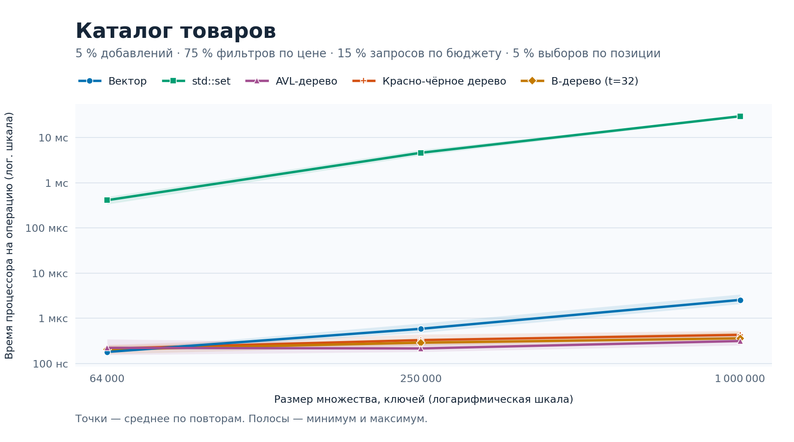

# Результаты бенчмарков

Меньше времени на операцию — лучше.
Графики показывают измеренное время и разброс повторов.

## Каталог товаров

[CSV](product_catalog.csv)

5 % добавлений · 75 % фильтров по цене · 15 % запросов по бюджету · 5 % выборов по позиции
В таблице — среднее время процессора на операцию, нс.

| Размер множества | AVL-дерево | B-дерево (t=32) | Красно-чёрное дерево | std::set | Вектор |
|---:|---:|---:|---:|---:|---:|
| 64 000 | 220,86 | 202,15 | 212,03 | 410 891,89 | 179,11 |
| 250 000 | 214,20 | 287,76 | 328,31 | 4 610 509,77 | 583,49 |
| 1 000 000 | 313,01 | 359,05 | 429,30 | 29 696 692,05 | 2 545,14 |

